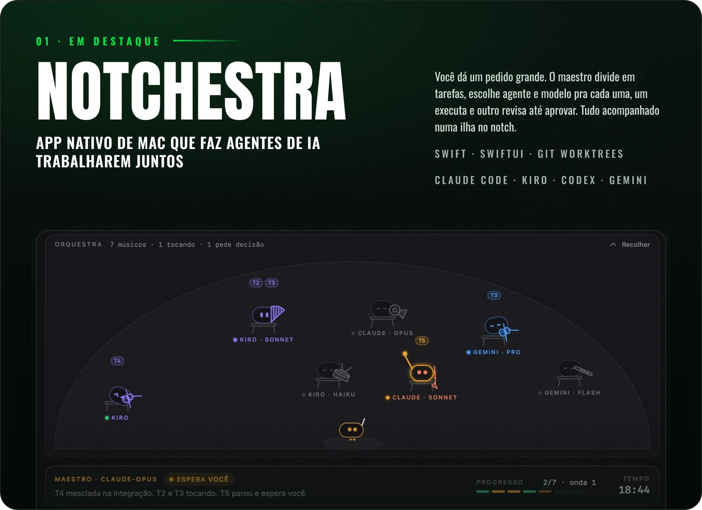
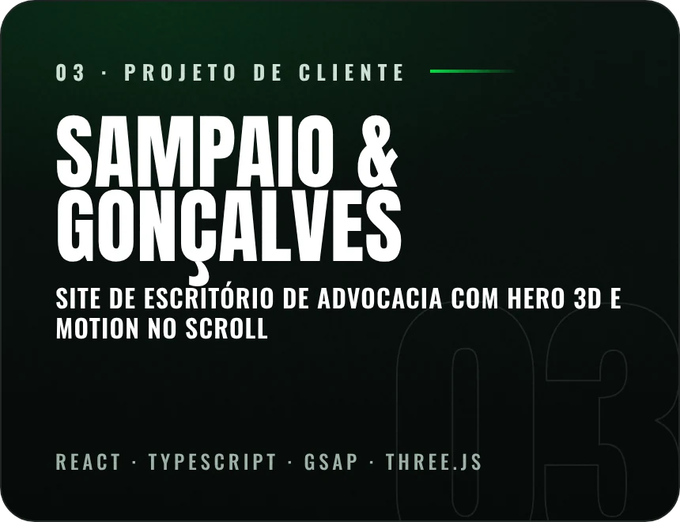

Estudo Sistemas de Informação na UFAC e faço a Web Academy. Programo com IA o dia inteiro, e o projeto que mais me ensinou foi justamente um app pra coordenar agentes de código. Fora isso, API em Java com Spring, front em React e site entregue pra cliente de verdade.

<a href="https://instagram.com/campelodev"><b>Instagram</b></a> &nbsp;·&nbsp;
<a href="https://www.tiktok.com/@campelodev_"><b>TikTok</b></a> &nbsp;·&nbsp;
<a href="https://www.linkedin.com/in/brenocampelo"><b>LinkedIn</b></a> &nbsp;·&nbsp;
<a href="mailto:brenoccfilho@gmail.com"><b>E-mail</b></a>

 

 

**Stack** &nbsp; Java · Spring Boot · TypeScript · React · Swift · SwiftUI · Python · Node.js · MySQL · Git

**Com IA** &nbsp; Claude Code · Kiro · Codex · Gemini CLI, orquestrados pelo Notchestra

**Agora** &nbsp; Spring Boot a fundo, testes de integração e estrutura de dados

Se você também está aprendendo a programar longe do eixo Rio–São Paulo, o resto está no <a href="https://instagram.com/campelodev"><b>@campelodev</b></a>.
